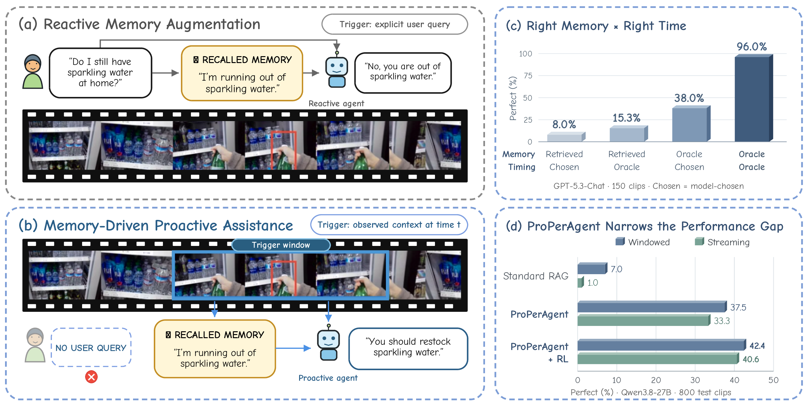
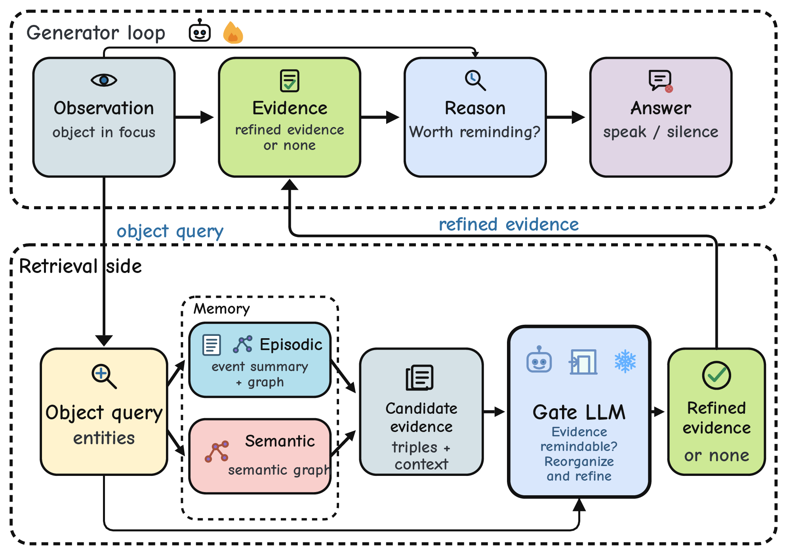

<div align="center">

# ProPerAgent<br>Toward Memory-Driven Proactive Assistance

**Shenglai Zeng**<sup>1,2</sup>, Xiao Yang<sup>2</sup>, Tiffany Ma<sup>2</sup>,
Xinyuan Zhang<sup>2</sup>, Nanshu Wang<sup>2</sup>, Deren Lei<sup>3</sup>,
Kai Sun<sup>2</sup>, Xilun Chen<sup>2</sup>, Tammy Stark<sup>2</sup>,
Xianhui Zhu<sup>2</sup>, Yuetai Li<sup>5</sup>, Rulin Shao<sup>3,5</sup>,
Tianxin Wei<sup>4</sup>, Rakesh Wanga<sup>2</sup>, Anuj Kumar<sup>2</sup>,
Jiliang Tang<sup>1</sup>, Wen-tau Yih<sup>3</sup>, Xin Luna Dong<sup>2</sup>

<sup>1</sup> Michigan State University &nbsp; <sup>2</sup> Meta Reality Labs<br>
<sup>3</sup> Meta Superintelligence Labs &nbsp; <sup>4</sup> Meta Recommendation Systems<br>
<sup>5</sup> University of Washington

**A personal memory should help an assistant know when to speak, not just what to say.**

[Dataset](https://huggingface.co/datasets/facebook/MemProBench) &nbsp; | &nbsp;
[Ego4D](https://ego4d-data.org/) &nbsp; | &nbsp;
[Quick Start]
[Quick Start](#quick-start) &nbsp; | &nbsp;
[Data Guide](docs/data.md) &nbsp; | &nbsp;
[Evaluation](docs/evaluation.md) &nbsp; | &nbsp;
[Citation](#citation)

</div>

<p align="center"></p>

## Overview

ProPerAgent studies **memory-driven proactive assistance**: an assistant observes
an ongoing activity, recalls relevant personal history, and decides whether that
history justifies a timely intervention.

This repository releases the **GPM inference harness**. It organizes long-term
history into episodic and semantic memory, retrieves evidence for the current
visual context, and uses a gate to distinguish an actionable open loop from a
merely relevant memory. A vision-language policy then produces a grounded
reminder or abstains with `NO_REMINDER`.

<p align="center"></p>

- **Grounded personal memory:** retrieve evidence from a graph of past events and semantic relations.
- **Selective intervention:** gate relevance into actionable evidence before the policy decides to speak.
- **Two causal paradigms:** fixed-window observations or chunked streaming context, with prior interventions retained to avoid repetition.

## Quick Start

Python 3.10 or newer is required. Start with a CPU-only integration test, which
uses synthetic data and scripted backends, not a real model or a paid judge:

```bash
git clone https://github.com/facebookresearch/Memo-Pro-Agent.git
cd Memo-Pro-Agent
python -m pip install -e '.[dev]'
python -m pytest -q tests/test_end_to_end.py
```

For actual inference, install graph retrieval and local embedding dependencies:

```bash
python -m pip install -e '.[ppr,embed]'
```

**Prepare data before running a model.** Follow the [Data Guide](docs/data.md) to
obtain authorized Ego4D source videos, rebuild clips using the supplied cut
specifications, and organize a selected subset. A local preparation tool is
provided; no videos or large indices are included in this repository.

```bash
python tools/prepare_propermem.py --help
```

Configure an OpenAI-compatible vision-language endpoint in `configs/example.yaml`.
The example uses the served model name `qwen` and one endpoint for both policy and
gate. For a user-managed vLLM installation, a possible serving command is:

```bash
vllm serve Qwen/Qwen3-VL-30B-A3B-Instruct --served-model-name qwen \
  --port 8000 --limit-mm-per-prompt image=32
```

This is a configuration example, **not a paper checkpoint or a paper-results
recipe**. Choose a model and serving setup that fit your hardware.

Build the retrieval graph and embeddings **locally** from the prepared history.
No prebuilt-index download is required. Construction uses the configured
extraction model (`gate_backend`) and embedding backend and can be expensive;
start with the single sample prepared in the Data Guide:

```bash
properagent-build-memory --config configs/example.yaml \
  --uid 01ef2c24_317-451 --workers 4
```

The [Data Guide](docs/data.md#3-build-the-retrieval-memory-locally) explains how to
verify the generated index and build the full selected set with `--all`. The CPU
Quick Start also checks build-to-retrieval wiring using scripted backends, not
real-model quality.

Then run either paradigm with timing-only scoring:

```bash
properagent-run --config configs/example.yaml --paradigm windowed \
  --label first-windowed --no-judge
properagent-run --config configs/example.yaml --paradigm streaming \
  --label first-streaming --no-judge
```

Outputs are generated locally under `runs/`; they are not included in the code
release. Timing-only scores are upper bounds, not judged paper metrics. See the
[Evaluation Guide](docs/evaluation.md) before enabling content judging or reporting
numbers.

## Data And Reproducibility

**Videos:** obtain the corresponding source videos from the official
[Ego4D website](https://ego4d-data.org/) under its access and license terms.
We do not redistribute those videos.

**User histories:** the 800 eval800 histories are hosted in
[facebook/MemProBench](https://huggingface.co/datasets/facebook/MemProBench).
The [Data Guide](docs/data.md#download-the-histories) provides a pinned snapshot
and single-sample or full-set download commands. The dataset is currently private
and requires authorized Hugging Face access. Retrieval graphs and embedding
matrices are built locally; no prebuilt-index download is required.

The [sample metadata](evalsets/clip_specs.jsonl) includes full Ego4D source video
IDs, cut timestamps, trigger windows, reference targets and memories, and
visibility records. No separate annotation download is needed: the preparation
tool combines this metadata with local histories and rebuilt clips, matched by
`sample_id`, to generate the inputs expected by the code. See the
[Data Guide](docs/data.md).

The first release focuses on inference and evaluation. Baseline campaigns,
internal cluster orchestration, intermediate results and real-data example clips
are not part of this checkout. Paper links and asset-download instructions will
be added when announced; do not treat missing assets as already released.

## Usage Notes

The default gate prompt is `version_free`; explicit alternatives remain available
through `gate.prompt_variant`. All model services use OpenAI-compatible APIs.
Embedding queries must use the same model identity and dimension as the memory
index. Both local sentence-transformer embeddings and a portable HTTP embedding
server are supported.

Slurm is optional. The [generic template](tools/slurm/run_gpm.sbatch) connects to
already-running services and requires your own scheduler resources, environment
and checkout path. It is not required for the Quick Start.

## Citation

Bibliographic identifiers and manuscript links will be added when announced.
The provisional citation uses the manuscript title and author list:

```bibtex
@misc{zeng2026properagent,
  title = {ProPerAgent: Toward Memory-Driven Proactive Assistance},
  author = {Zeng, Shenglai and Yang, Xiao and Ma, Tiffany and Zhang, Xinyuan
    and Wang, Nanshu and Lei, Deren and Sun, Kai and Chen, Xilun
    and Stark, Tammy and Zhu, Xianhui and Li, Yuetai and Shao, Rulin
    and Wei, Tianxin and Wanga, Rakesh and Kumar, Anuj and Tang, Jiliang
    and Yih, Wen-tau and Dong, Xin Luna},
  year = {2026}
}
```
